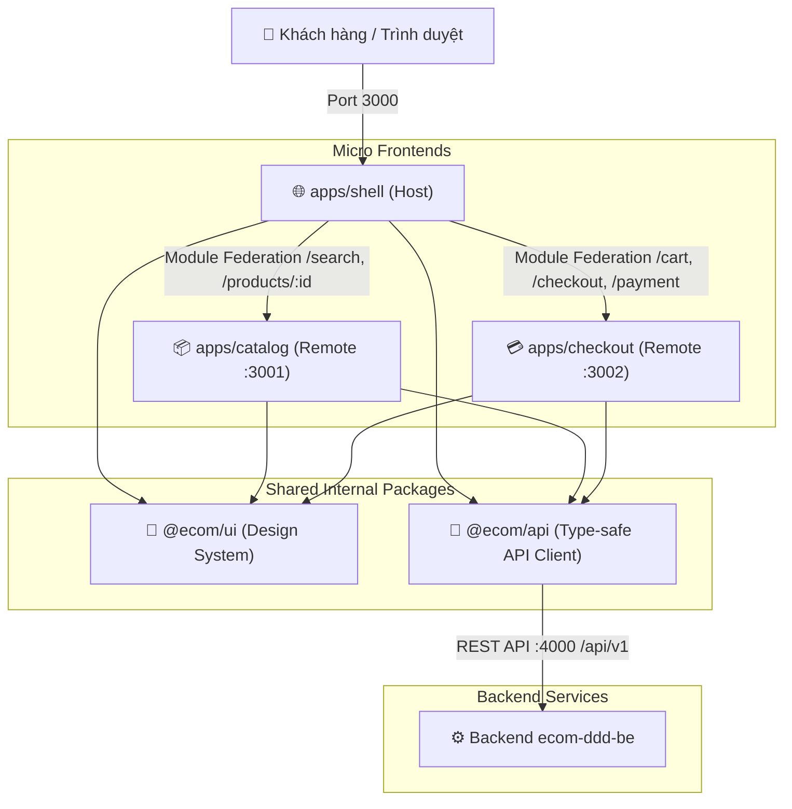

# 🛒 Ecom Micro-Frontend Platform (`ecom-ui`)

Hệ thống giao diện thương mại điện tử kiến trúc **Micro-Frontend** hiện đại, xây dựng dưới dạng **Monorepo** với **Turborepo** và **pnpm Workspaces**, kết nối linh hoạt thông qua **Vite Module Federation**.

---

## 🏗️ Kiến trúc tổng thể (Architecture Overview)

Hệ thống được thiết kế theo hướng **Decoupled Micro-Frontends**:
- **Host Shell (`apps/shell`)**: Điều phối routing chính, quản lý session xác thực (Auth), tài khoản người dùng, trang chủ (Storefront), và tích hợp các remote micro-frontend.
- **Catalog MFE (`apps/catalog`)**: Quản lý tìm kiếm, bộ lọc đa chiều (Faceted Search), danh sách sản phẩm và trang chi tiết sản phẩm (PDP).
- **Checkout MFE (`apps/checkout`)**: Quản lý giỏ hàng (Cart), quy trình đặt hàng (Checkout), thanh toán trực tuyến (Payment) và màn hình hoàn tất đơn hàng.
- **Shared Packages (`packages/*`)**: Cung cấp Design System chuẩn hoá (`@ecom/ui`) và API client type-safe tự sinh từ OpenAPI (`@ecom/api`).



---

## 📁 Cấu trúc Monorepo (Workspace Structure)

```text
frontend/ecom-ui/
├── apps/
│   ├── shell/                  # [Port 3000] Host Application
│   │   ├── src/
│   │   │   ├── features/       # Feature-driven (auth, home, profile, addresses, orders)
│   │   │   ├── hooks/common/   # Generic utility hooks (useCountdown, useDebounce, ...)
│   │   │   ├── remotes/        # Dynamic Module Federation wrappers & Error Boundaries
│   │   │   └── services/       # API consumption services
│   │   └── vite.config.ts      # Host Module Federation config
│   │
│   ├── catalog/                # [Port 3001] Catalog Remote MFE
│   │   ├── src/
│   │   │   ├── features/       # Products, categories, search facets, PDP
│   │   │   └── pages/          # SearchPage, ProductDetailPage
│   │   └── vite.config.ts      # Remote federation exposing SearchPage, ProductDetailPage
│   │
│   ├── checkout/               # [Port 3002] Checkout Remote MFE
│   │   ├── src/
│   │   │   ├── features/       # Cart, checkout flow, payment mutation, order success
│   │   │   └── pages/          # CartPage, CheckoutPage, PaymentPage, OrderSuccessPage
│   │   └── vite.config.ts      # Remote federation exposing CartPage, CheckoutPage, ...
│   │
│   └── seo-ssr/                # [Port 3003] Next.js 15 SEO & Public SSR Application
│       ├── src/
│       │   ├── app/            # App Router: /, /products/[slug], /categories/[slug], /search, sitemap, robots
│       │   ├── components/     # Header, Footer (SSR-friendly with transition boundaries)
│       │   └── services/       # Server-side direct API fetchers with ISR caching
│       └── next.config.ts
│
├── packages/
│   ├── ui/                     # Shared UI Components & Tailwind Design System
│   │   ├── src/                # Button, Card, Tag, TextField, Dropdown, Modal, Icons, ErrorBoundary...
│   │   └── index.ts
│   │
│   └── api/                    # Centralized Type-safe API Client
│       ├── openapi.json        # Backend OpenAPI Swagger contract
│       ├── src/
│       │   ├── client.ts       # Typed fetch client with refresh token & error interceptor
│       │   ├── generated/      # openapi-typescript generated types
│       │   └── error-messages.ts # Friendly Vietnamese error message mapper
│       └── index.ts
│
├── package.json
├── pnpm-workspace.yaml
└── turbo.json
```

---

## ⚡ Công nghệ cốt lõi (Tech Stack)

| Thành phần | Công nghệ sử dụng |
| :--- | :--- |
| **Core Framework** | [React 19](https://react.dev/), [TypeScript](https://www.typescriptlang.org/) |
| **Build & Bundler** | [Vite](https://vite.dev/), [@module-federation/vite](https://module-federation.io/) |
| **Monorepo Engine** | [Turborepo](https://turbo.build/), [pnpm](https://pnpm.io/) |
| **Styling** | [Tailwind CSS v4](https://tailwindcss.com/) với semantic CSS variables |
| **State & Data Fetching** | [TanStack React Query v5](https://tanstack.com/query) |
| **Routing** | [React Router v7](https://reactrouter.com/) |
| **Form & Validation** | [React Hook Form](https://react-hook-form.com/), [Zod](https://zod.dev/) |
| **Linter & Formatter** | [Oxlint](https://oxc.rs/) (siêu tốc), [Prettier](https://prettier.io/) |
| **Testing** | [Vitest](https://vitest.dev/), [@testing-library/react](https://testing-library.com/) |
| **Git Hooks & Standards** | [Husky](https://typicode.github.io/husky/), [Lint-staged](https://github.com/lint-staged/lint-staged), [Commitlint](https://commitlint.js.org/) |

---

## 🚀 Hướng dẫn cài đặt & Khởi chạy (Getting Started)

### Yêu cầu môi trường
- **Node.js**: `>= 20.x`
- **pnpm**: `>= 10.x` (`corepack enable` hoặc cài đặt pnpm toàn cục)

### 1. Cài đặt dependencies
Tại thư mục gốc `frontend/ecom-ui`:
```bash
pnpm install
```

### 2. Khởi chạy môi trường phát triển (Development)
Chạy đồng thời tất cả các apps (Shell, Catalog, Checkout) qua Turborepo:
```bash
pnpm dev
```

Sau khi khởi chạy:
| Ứng dụng | Địa chỉ Local | Vai trò |
| :--- | :--- | :--- |
| **Nginx Gateway** | `http://localhost:8080` | Reverse Proxy kết hợp SSR + SPA (Bật qua `pnpm gateway:up`) |
| **SEO SSR** | `http://localhost:3003` | Next.js 15 SSR cho Trang chủ, PDP, Search, Sitemap |
| **Shell Host** | `http://localhost:3000` | Trang chủ, Auth, Account, Host chính |
| **Catalog MFE** | `http://localhost:3001` | Remote Micro-frontend danh mục & sản phẩm |
| **Checkout MFE** | `http://localhost:3002` | Remote Micro-frontend giỏ hàng & thanh toán |

#### 🎛️ Bật / Tắt (Toggle) Nginx Gateway & SSR
```bash
# Bật Gateway Nginx Local
pnpm gateway:up

# Tắt Gateway Nginx Local
pnpm gateway:down

# Reload cấu hình Nginx sau khi sửa
pnpm gateway:reload
```
* **Bật/Tắt SSR tức thì:**
  * Mặc định truy cập `http://localhost:8080` $\rightarrow$ Bật SSR (dùng `apps/seo-ssr`).
  * Thêm param `?ssr=0` hoặc cookie `disable_ssr=1` $\rightarrow$ Tắt SSR (tự động fallback 100% về Shell SPA `apps/shell`).

> [!NOTE]
> Để các tính năng call API hoạt động đầy đủ, hãy đảm bảo Backend (`ecom-ddd-be`) đang chạy tại cổng `http://localhost:4000`.

---

## 🧪 Kiểm thử & Chất lượng mã nguồn (Quality Assurance)

Dự án áp dụng quy chuẩn kiểm thử và kiểm tra mã nguồn tự động nghiêm ngặt:

```bash
# Chạy toàn bộ Test Suites trên 5 workspace packages (Vitest)
pnpm turbo run test

# Kiểm tra TypeScript typecheck toàn diện không phát sinh lỗi
pnpm turbo run typecheck

# Chạy linter siêu tốc với Oxlint (0 errors, 0 warnings)
pnpm turbo run lint

# Build production cho toàn bộ ứng dụng và packages
pnpm turbo run build
```

---

## 📐 Quy chuẩn kiến trúc & Thiết kế (Key Conventions)

1. **Feature-Driven Hybrid Hook (Rule of Thumb)**:
   - Các hooks gắn liền với logic nghiệp vụ domain đặt tại `src/features/<feature>/hooks/` (ví dụ: `useHomeCatalog`, `useCartQuery`, `useProductFacetsQuery`).
   - Các hooks tiện ích tái sử dụng chung không dính domain đặt tại `src/hooks/common/` (ví dụ: `useCountdown`, `useFocusFirstInvalidField`, `useDebounce`).
2. **100% Path Alias (`@/...`)**:
   - Nghiêm cấm dùng relative import leo tầng nhiều cấp (`../../..`). Mọi import nội bộ trong từng app đều xuất phát từ alias `@/...`.
3. **Decoupled Micro-Frontend Communication**:
   - Không chia sẻ bộ nhớ state phức tạp trực tiếp giữa các MFE độc lập.
   - Giao tiếp giữa Host và Remotes thực hiện qua **Custom DOM Events** chuẩn (`cart:changed`, `auth:logout`), đảm bảo độc lập triển khai (independently deployable).
4. **Xử lý lỗi tập trung & Thân thiện người dùng**:
   - Tất cả request backend đi qua client `@ecom/api`.
   - Lỗi từ backend được tự động chuẩn hoá thành câu tiếng Việt tự nhiên, thân thiện và hiển thị qua hệ thống Toast thông báo toàn cục, form inputs chỉ tập trung hiển thị lỗi validation nghiệp vụ từ Zod.
5. **Idempotency**:
   - Tất cả hành động nhạy cảm như tạo đơn hàng hoặc thanh toán đều gửi kèm `Idempotency-Key` để ngăn chặn việc gửi trùng lặp dữ liệu.

---

## 📄 License
Dự án được phát triển phục vụ mục đích học tập và xây dựng kiến trúc thương mại điện tử chuẩn doanh nghiệp.
